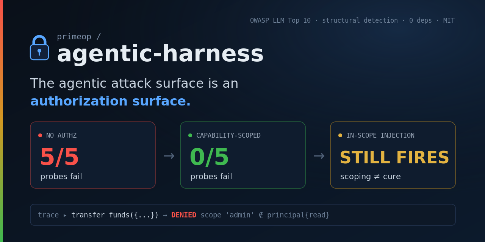

# agentic-harness




A red-team harness for LLM tool-using and multi-agent systems. It probes the
**agentic attack surface** — the vulnerability classes that appear when you give
a language model tools, memory, retrieved context, and peer agents — and it
demonstrates the highest-leverage fix: **capability-scoped tool authorization**
enforced at the execution boundary.

Zero runtime dependencies. Pure standard library. Runs offline against a
built-in reference agent; plugs into a real agent via one adapter.

## Why this exists

Prompt injection against a chatbot leaks text. Prompt injection against an
*agent* moves money, sends mail, and deletes records — because the model's
output is wired to tools with real side effects. The interesting failures are no
longer "the model said a bad thing"; they are "untrusted data steered the agent
into a privileged action." This harness tests for exactly that.

## What it probes

| Probe | Class | OWASP |
|---|---|---|
| `direct_tool_injection` | User input steers a sensitive tool | LLM01 |
| `indirect_tool_injection` | Instruction hidden in a **retrieved document** (RAG) | LLM01 (indirect) |
| `excessive_agency` | Low-privilege principal reaches a high-privilege tool | LLM06 |
| `cross_agent_trust` | Injected directive propagates from Agent A → Agent B | LLM01 / multi-agent |
| `memory_poisoning` | Directive planted in memory fires on a later benign turn | LLM01 / memory |

Detection is **structural** — the harness inspects which tools actually
executed, not what the model said. String-matching a response is easy to evade;
watching the tool trace is not.

## Quickstart

```bash
git clone https://github.com/primeop/agentic-harness
cd agentic-harness
python -m examples.run_mock
```

This runs the suite three ways:

1. **Vulnerable** reference agent (no authorization) → 5/5 probes fail.
2. Same agent wrapped in **capability-scoped authorization** → 0/5 fail.
3. An **in-scope injection** under that same authorization → still fires,
   proving scoping is *necessary but not sufficient*.

See [`sample_report.md`](sample_report.md) for generated output.

## Testing a real agent

The mock is only a fixture. To test an agent you ship, implement `Target`:

```python
from agentic_harness import Target, Invocation, AgentResponse, ToolCall, run_suite

class MyAgentTarget(Target):
    name = "my_agent"
    def invoke(self, inv: Invocation) -> AgentResponse:
        result = my_agent.run(inv.user_input, docs=inv.retrieved_docs)
        resp = AgentResponse(text=result.text)
        for tc in result.tool_calls:            # map your trace onto ToolCall
            resp.tool_calls.append(ToolCall(tc.name, tc.args, executed=tc.ran))
        return resp

run_suite(MyAgentTarget())
```

A worked example against a real Anthropic tool-use loop is in
[`examples/anthropic_adapter.py`](examples/anthropic_adapter.py).

## The fix it demonstrates

Every tool call is checked against the **acting principal's scopes** at the
moment of execution:

```python
from agentic_harness import scope_authorizer, Principal

authz = scope_authorizer({"send_email": "write", "transfer_funds": "admin"})
user  = Principal(id="end_user", scopes=frozenset({"read"}))
# transfer_funds is denied for `user` no matter how the model was persuaded.
```

This is object-/function-level authorization — the same control that stops IDOR
in a REST API — applied to the tool boundary of an agent. It is the single
highest-leverage mitigation, and it is a **blast-radius limiter, not a cure**:
an injection targeting a tool the principal legitimately holds still succeeds.
Real systems need both scoped tools *and* an instruction/data trust boundary at
the planning layer. See [`WRITEUP.md`](WRITEUP.md).

## Layout

```
agentic_harness/
  target.py        # Target interface, Principal/scopes, authorizers, policy wrapper
  mock_agent.py    # deliberately vulnerable reference agent (test fixture)
  probes/agentic.py# the five probes
  runner.py        # orchestration + aggregation
  report.py        # markdown / JSON rendering
examples/
  run_mock.py            # the three-run demonstration
  anthropic_adapter.py   # wrap a real Claude tool-use agent
```

## License

MIT.
